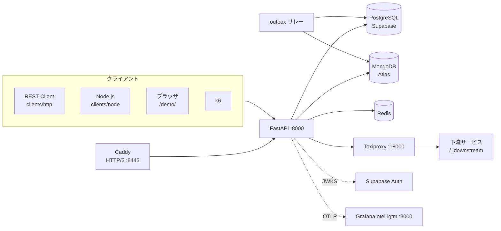

# WebAPI 設計・実装デモ

研修テキスト「WebAPIの設計と実装のコツ」の各節に対応したデモ環境。
FastAPI + PostgreSQL（Supabase）+ MongoDB（Atlas）+ Redis で構成し、
クライアントには VS Code の REST Client、Node.js、ブラウザを使う。

[](https://codespaces.new/OWNER/sec-webapi-demo)

## 構成



| 役割 | ローカルモード（既定） | クラウドモード |
|---|---|---|
| PostgreSQL + 認証 | Supabase CLI（`supabase start`） | Supabase |
| MongoDB | Docker（mongo:8.0） | MongoDB Atlas |
| Redis / Toxiproxy / otel-lgtm / Caddy | Docker Compose | Docker Compose |

ローカルモードはアカウント登録なしで全デモが動く。クラウドモードは `.env` の接続先を差し替えるだけで切り替わる。

## セットアップ

### GitHub Codespaces（推奨）

1. 上のバッジから Codespace を作成する（4 コア以上）。依存関係は自動でインストールされる。
2. ターミナルで次を実行する。

```bash
make bootstrap   # Docker 起動 → Supabase 起動 → .env 生成 → スキーマ作成 → シード投入（数分）
make run         # 別ターミナルで API を起動
make doctor      # すべて ✔ になれば準備完了
```

### ローカル（VS Code Dev Container）

Docker Desktop と VS Code の Dev Containers 拡張を入れ、「Reopen in Container」で開く。以降は Codespaces と同じ。

Dev Container を使わない場合は、Python 3.12 / [uv](https://docs.astral.sh/uv/) / Node.js 22 / Docker を用意し、`make setup` から始める。

### クラウドモード（Supabase + MongoDB Atlas）

1. Supabase でプロジェクトを作成し、Project Settings から接続文字列、API キーを取得する。
2. MongoDB Atlas でクラスターを作成し、Network Access に接続元 IP を許可する。
3. `.env` の `DATABASE_URL` / `MONGODB_URI` / `SUPABASE_*` を書き換え、`APP_MODE=cloud` にする（書式は `.env.example` のコメント参照）。
4. 実行する。

```bash
make infra-up http-env db-init seed
make run
make doctor
```

Supabase の Transaction pooler（ポート 6543）を使う場合は `DB_STATEMENT_CACHE_SIZE=0` にする。
テーブルは `api_demo` スキーマに作るため、Supabase の Data API には公開されない。

## デモ一覧

各デモの前に `make reset` を実行すると、状態が初期化される（大量のシードデータは残る）。
REST Client のファイルは上から順に `Send Request` すれば台本どおりに進む。

各台本のリクエストごとの解説は [docs/http/](docs/http/README.md) にある。
| — | MongoDB のデータの確認 | [docs/mongodb-data.md](docs/mongodb-data.md)、`clients/mongodb/explore.mongodb.js` |

| 節 | 内容 | 実行するもの |
|---|---|---|
| 1-1 | REST / SSE / WebSocket の比較 | ブラウザで `http://localhost:8000/demo/`、`clients/http/01-realtime-openapi.http` |
| 1-1 | GraphQL（N+1 と DataLoader、深さ・エイリアス制限） | `clients/http/01-2-graphql.http`、ブラウザで `/graphql`（GraphiQL） |
| 1-1 | gRPC（契約、ステータスコード、デッドライン、ストリーミング） | `make grpc-server` + `make grpc-demo`、`make grpcurl-list` |
| 1-2 | OpenAPI → Tool Use 定義、MCP サーバー | `make tools`、Claude Code で `.mcp.json` の `sec-webapi-demo` を有効化 |
| 1-3 | OpenAPI 3.1、Spectral、Prism | `make lint-openapi`、`make mock`、`http://localhost:8000/docs` |
| 2-1 | リソース指向設計とステータスコード | `clients/http/02-1-resources-status.http` |
| 2-2 | バージョニング、Deprecation / Sunset、Brownout | `02-2-versioning.http`、`make brownout-on` / `brownout-off` |
| 2-3 | カーソル vs オフセット、フィルタ、ESR インデックス | `02-3-pagination.http`、`make explain-pg`、`make explain-mongo` |
| 2-4 | RFC 9457 Problem Details | `02-4-problem-details.http` |
| 3-1 | Supabase Auth の JWT を JWKS / 共有鍵で検証 | `03-1-auth.http` |
| 3-2 | BOLA / BFLA（脆弱版と安全版の比較） | `03-2-authorization.http` |
| 3-3 | トークンバケットによるレートリミット | `03-3-ratelimit.http`、`npm run ratelimit`、`make k6-ratelimit` |
| 3-4 | Mass Assignment、プロトタイプ汚染 | `03-4-validation.http`、`npm run pollution` |
| 4-1 | HTTP/3（Caddy で QUIC を終端、Alt-Svc） | `make h3-check` |
| 4-2 | Idempotency-Key、Transactional Outbox、冪等コンシューマ | `04-2-idempotency.http`、`npm run idempotency`、`make relay`、`make relay-redeliver` |
| 4-3 | Cache-Control、ETag / 304、Cache-Aside、If-Match / 412 | `04-3-cache.http` |
| 4-4 | タイムアウト、デッドライン伝播、リトライ、サーキットブレーカー | `04-4-resilience.http`、`npm run resilience` + `make chaos-latency` / `chaos-down` / `chaos-reset` |
| 5-1 | Schemathesis、oasdiff による破壊的変更の検出 | `make fuzz`、`make oasdiff` |
| 5-2 | AI コーディングアシスタントによる実装補助 | Claude Code などで `CLAUDE.md` と `contracts/openapi.baseline.json` を参照させる |
| 5-3 | OpenTelemetry（トレース・メトリクス・ログ相関） | Grafana `http://localhost:3000` → Explore → Tempo / Prometheus / Loki |

### デモユーザー

| ユーザー | 役割 | データ |
|---|---|---|
| alice@example.com | 一般 | 注文 100 万件（ページネーション比較用） |
| bob@example.com | 一般 | 注文 3 件（pending / paid / shipped） |
| carol@example.com | 管理者 | 商品の登録・更新・削除、管理者 API |

パスワードは `.env` の `DEMO_PASSWORD`（既定 `Passw0rd!demo`）。

## ディレクトリ構成

```
app/                 FastAPI（routers/ に章ごとのエンドポイント）
  routers/vuln.py    ⚠ 意図的に脆弱なエンドポイント（比較デモ専用）
  workers/           outbox リレー
  mcp_server.py      MCP サーバー
clients/
  http/              REST Client の台本（節ごと）
  node/              Node.js クライアント（冪等性、回復性、レートリミット、プロトタイプ汚染）
  browser/           1-1 の比較ページ（/demo/ で配信）
  k6/                負荷テスト
contracts/           OpenAPI のベースラインと破壊的変更の例
db/schema.sql        PostgreSQL のスキーマ
infra/               Caddy / Toxiproxy の設定
scripts/             初期化・シード・リセット・事前チェック・実行計画比較など
docs/                講師向け手順書
```

## 注意

- `/vuln/*` は教材用の脆弱なエンドポイント。`ENABLE_VULN_ENDPOINTS=false` で無効化できる。コードを流用する場合は安全版（`/v1/*`）を参照すること。
- 下流サービス（`/_downstream`）はデモを単純にするため同じプロセスに同居させている。
- `make fuzz` は注文を大量に作成するので、終了後に `make reset` を実行する。
- シード件数は `.env` の `SEED_ORDERS` / `SEED_PRODUCTS` で変更できる。容量の小さい無料枠では減らすとよい。
